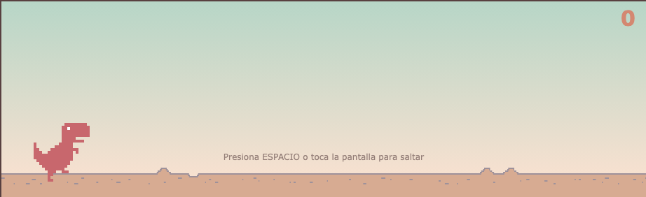

# 🦖 Juego del Dinosaurio

Clon del famoso juego del dinosaurio de Chrome (el que aparece cuando te quedas sin conexión), construido desde cero con **HTML, CSS y JavaScript puro**, sin frameworks ni librerías externas.

Fue uno de mis primeros proyectos mientras estaba aprendiendo a programar. Lo retomé para limpiarlo, corregirle bugs y dejarlo jugable en la web.



## 🎮 Jugar

👉 **[Jugar en vivo](https://m4nuel-ceron.github.io/Juego-del-Dinosaurio/)**

### Controles

- **Escritorio:** presiona `ESPACIO` (o haz clic) para saltar.
- **Móvil:** toca la pantalla para saltar.
- Cuando pierdas, presiona `ESPACIO` o toca la pantalla de nuevo para reiniciar.

## ✨ Características

- Animación del dinosaurio corriendo con sprites.
- Generación aleatoria de cactus (obstáculos) y nubes de fondo.
- Detección de colisiones con cajas de margen ajustadas para que se sienta justo.
- Dificultad progresiva: la velocidad del juego aumenta con el puntaje (5, 10 y 20 puntos), y el fondo cambia de color simulando el paso del día (mediodía, tarde, noche).
- Contador de puntaje en tiempo real.
- Reinicio rápido sin recargar la página.
- Soporte táctil para jugar desde el celular.

## 🛠️ Tecnologías

- HTML5
- CSS3 (animaciones con `@keyframes`, sprites con `background-position`)
- JavaScript (vanilla, sin dependencias)

## 🚀 Cómo ejecutarlo localmente

No necesita instalación ni dependencias. Solo necesitas un servidor local, porque el juego carga imágenes por lo que abrir el `index.html` directamente (`file://`) puede fallar por restricciones del navegador.

```bash
git clone https://github.com/M4NUEL-CERON/Juego-del-Dinosaurio.git
cd Juego-del-Dinosaurio
python3 -m http.server 8080
```

Luego abre [http://localhost:8080](http://localhost:8080) en tu navegador.

## 📁 Estructura del proyecto

```
Juego-del-Dinosaurio/
├── index.html            # Estructura de la página
├── css/
│   └── style.css        # Estilos y animaciones
├── js/
│   └── main.js           # Lógica del juego (bucle, física, colisiones, puntaje)
├── assets/
│   └── img/
│       ├── dino.png      # Sprite del dinosaurio
│       ├── cactus1.png   # Sprite de obstáculo (cactus pequeño)
│       ├── cactus2.png   # Sprite de obstáculo (cactus grande)
│       ├── nube.png      # Sprite de nube
│       └── suelo.png     # Sprite del suelo
└── screenshot.png        # Captura usada en este README
```

## 🙋 Autor

**Manuel Cerón** — [@M4NUEL-CERON](https://github.com/M4NUEL-CERON)

## 📄 Licencia

Este proyecto está bajo la licencia [MIT](LICENSE).
